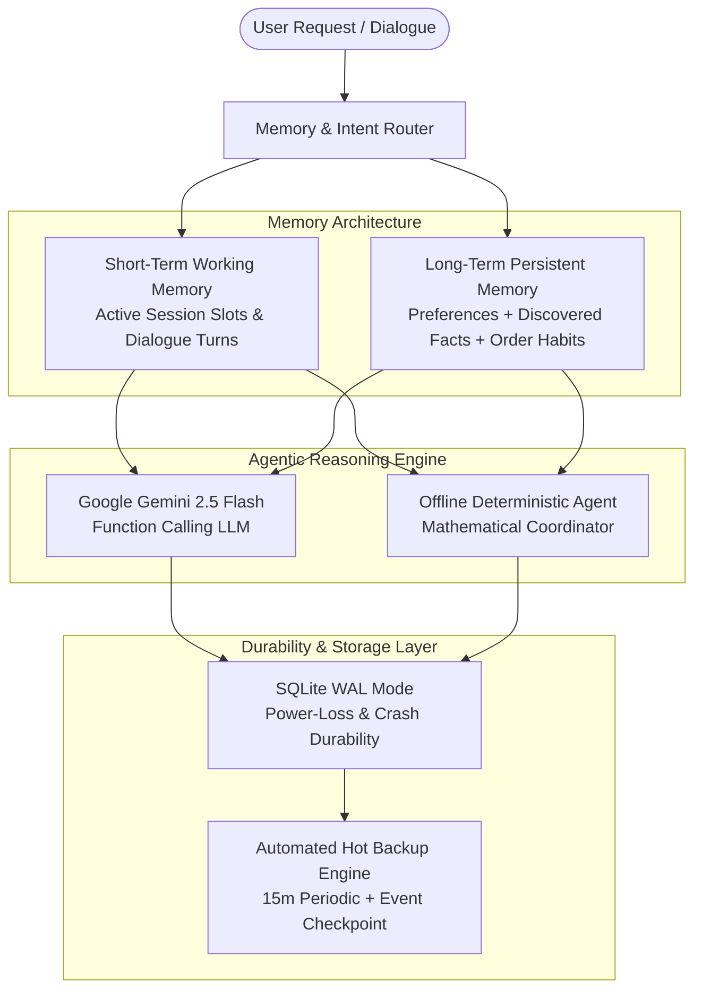

# 🍕 FoodieAgent Enterprise — Intelligent Food Ordering Multi-Agent System (v2.5)

> **Enterprise AI Showcase**: An explainable, multi-agent food ordering system featuring **Dual-Tier Memory (Long Short-Term Memory - LTM + STM)**, **Power-Loss Durability (SQLite WAL Mode + Automated Hot Backups)**, **Dynamic Model Chatbot (Google Gemini 2.5 Flash + Deterministic Fallback)**, real tool-calling, and deterministic constraint enforcement.

---

## 📌 Problem Statement

> **“Order a vegetarian pizza under ₹500 delivered within 30 minutes.”**

FoodieAgent decomposes this request, coordinates 6 specialist autonomous agents, verifies strict dietary labels, calculates exact subtotal + delivery + 5% food tax, checks delivery timelines, gates actions behind user confirmation, and monitors order status with persistent in-app notifications.

---

## 🌟 What's New in v2.5 (Senior Developer Architecture)

### 1. 🧠 Dual-Tier Long Short Term Memory (LSTM)
- **Short-Term Working Memory (STM)**:
  - Manages active multi-turn conversational session context (`fa_chat_sessions` and `fa_chat_messages`).
  - Contextual Slot Tracking: tracks active category, budget headroom, dietary filters, recently presented candidate dishes, and pending checkout ticket drafts.
  - Anaphoric & Elliptic Query Resolution: allows the user to say *"order the first one"*, *"make it pure veg"*, *"suggest something under 350"*, or *"confirm order"* without repeating previous constraints.
- **Long-Term Persistent Memory (LTM)**:
  - Stores explicit profile preferences (`fa_preferences`).
  - **Semantic Fact Extraction**: Automatically detects and consolidates facts from conversation into `fa_memory_facts` (e.g., *"I am allergic to mushrooms"*, *"Always keep delivery under 30 mins"*, *"I love spicy food"*).
  - **Order Habit Profiling**: Aggregates order frequency, average spend in ₹, and favorite dishes.
  - Injected directly into Gemini system instructions and the offline coordinator.

### 2. ⚡ Sudden Power-Loss Safety & Automated Hot Backup System
> **"What if power supply goes suddenly? What about data?"**
- **Crash Durability via SQLite Write-Ahead Logging (WAL)**:
  - Configured with `PRAGMA journal_mode = WAL;`, `PRAGMA synchronous = NORMAL;`, and `PRAGMA foreign_keys = ON;`.
  - In WAL mode, changes are appended to a write-ahead log rather than overwriting database pages directly.
  - **Zero Data Loss / Corruption Guarantee**: If power cuts out abruptly mid-write, the main database file is physically undamaged. On boot, SQLite automatically recovers committed transactions from the WAL log and safely discards incomplete ones.
- **Automated Hot Backup System (`lib/backup.js`)**:
  - Automatically executes `PRAGMA wal_checkpoint(TRUNCATE)` and takes hot atomic snapshots of the database.
  - **Scheduled Interval**: Periodic automated backup every 15 minutes.
  - **Transaction-Triggered**: Debounced automatic hot snapshot upon critical business events (order placement, profile reset).
  - **Integrity & Checksum**: Computes SHA-256 hash and validates database integrity with `PRAGMA quick_check`.
  - **Safe Restore Engine**: 1-click restore from UI or API with pre-restore emergency snapshots.
  - **Retention Management**: Retains the latest 10 snapshots to prevent disk exhaustion.

### 3. 🤖 Modern Dynamic Model Chatbot
- **Configurable Models**: Seamlessly switch between:
  - `gemini-2.5-flash` (Next-gen reasoning, recommended default)
  - `gemini-2.0-flash` (High-speed conversational agent)
  - `gemini-1.5-flash` (High efficiency)
  - `gemini-1.5-pro` (Deep multi-step reasoning)
  - `offline-rule-engine` (100% offline deterministic engine)
- **Multi-Turn Context Aware**: The chatbot remembers previously recommended items, allowing seamless commands like *"Order the first one"* or *"Add garlic bread to it"*.
- **Tool Calling Suite**: 10 callable backend tools for discovery, menu details, dish comparison, combo suggestion, order tracking, checkout preparation, and memory persistence.

---

## 🏗️ Architecture & Dual-Tier Memory Flow



---

## 📐 Scoring Formula & Hard Rules

$$\text{Composite Score} = 0.40 \times \text{Price Headroom} + 0.35 \times \text{Delivery Headroom} + 0.25 \times \text{Rating}$$

- **Hard Rules Applied First**: Items exceeding budget, breaching delivery deadlines, or violating dietary preferences receive score 0 and are disqualified before ranking.
- **Integer Paise Arithmetic**: All calculations use integer paise to eliminate floating-point rounding errors (e.g. ₹500 = `50000` paise).
- **Assumed 5% Food Tax**: Food bill is calculated transparently as: `(UnitPrice × Quantity) + Delivery Fee + 5% Tax on Food`.

---

## 🧪 Automated Unit Test Suite

Run the full automated test suite verifying all 10 components:

```bash
npm test
```

### Verified Test Cases:
1. `parseFoodRequest` constraint extraction (diet, budget, time, category).
2. Integer paise arithmetic and 5% food tax calculation.
3. SQLite catalogue queries for restaurants and menus.
4. Dietary filtering (strict separation of vegetarian and non-vegetarian items).
5. Hard constraint enforcement and confirmation gate for orders.
6. End-to-end intent router, tools execution, and checkout tickets.
7. **Long Short Term Memory (LTM + STM)**: Session state, slot tracking, anaphoric reference resolution, and semantic fact extraction.
8. **Power-Loss Durability & Hot Backup/Restore**: WAL mode verification, SHA-256 snapshot creation, and atomic restore.
9. **Supported Models API**: Verifies dynamic model configuration.

---

## 🚀 Getting Started

### 1. Prerequisites
- Node.js v20+ or v22+ (Built-in `node:sqlite` support)
- No external database or Redis required!

### 2. Setup
```bash
git clone <repo-url>
cd Foodie_Agent
npm install
```

### 3. Environment Variables (Optional)
Copy `.env.example` to `.env`:
```bash
cp .env.example .env
```
Add your optional Google Gemini API key if you want live LLM capabilities:
```env
PORT=3000
GEMINI_API_KEY=your_gemini_api_key_here
GEMINI_MODEL=gemini-2.5-flash
BACKUP_INTERVAL_MINUTES=15
```
*(If omitted, FoodieAgent runs 100% locally in Offline Deterministic Agent Mode).*

### 4. Run the Server
```bash
npm start
```
Open **http://localhost:3000** in your browser.
- **Project Guide**: http://localhost:3000/guide.html
- **Viva Preparation**: http://localhost:3000/viva.html

---

## 📡 REST API Reference

| Endpoint | Method | Description |
| :--- | :--- | :--- |
| `/api/bootstrap` | `GET` | Bootstraps workspace, catalogue, preferences, and notifications. |
| `/api/recommend` | `POST` | Multi-agent recommendation engine (deterministic 40/35/25 scoring). |
| `/api/agent-chat` | `POST` | Conversational chatbot with LTM/STM memory, model selection & tool calling. |
| `/api/memory` | `GET, POST, DELETE` | Inspects and manages Long-Term Memory facts & STM working session. |
| `/api/backup` | `GET, POST` | Lists snapshots, creates instant hot backups, or restores from snapshot. |
| `/api/models` | `GET` | Lists supported Gemini models and current active model. |
| `/api/orders` | `GET, POST` | Retrieves user orders or places confirmed simulated orders. |
| `/api/orders/:id` | `GET, POST` | Tracks order milestones or advances status with persistent notifications. |
| `/api/preferences`| `GET, PUT, DELETE`| Reads, updates, or deletes stored user preferences. |

---

## 🎓 College Viva & Jury Presentation Tips
- **Multi-Agent Coordination**: Explain the Contract Net-inspired decomposition into 6 specialist agents.
- **Dual-Tier Memory**: Highlight why separating STM (session context) from LTM (persistent preferences/facts) prevents context pollution.
- **Crash Durability**: Emphasize how SQLite WAL mode guarantees that a sudden power cut ("supply gone") will never corrupt data, paired with automated hot backups.
- **Transparency**: Explain why integer paise and explicit user confirmation are critical for financial AI systems.
